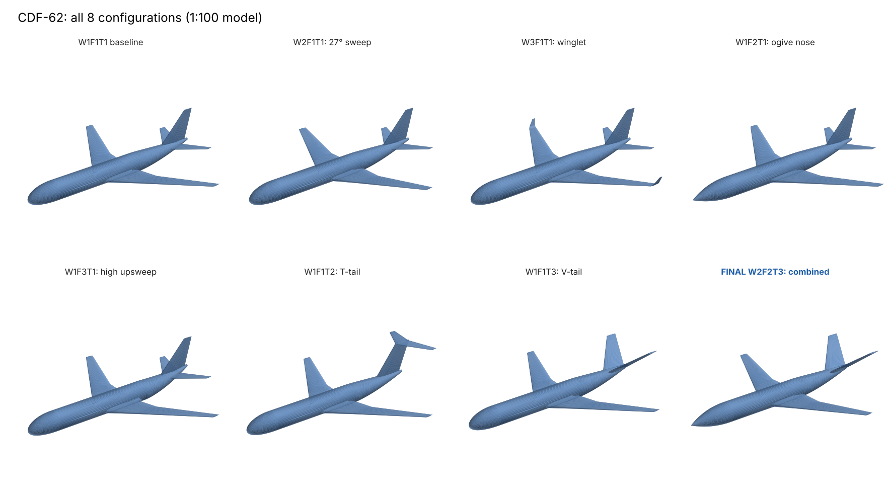
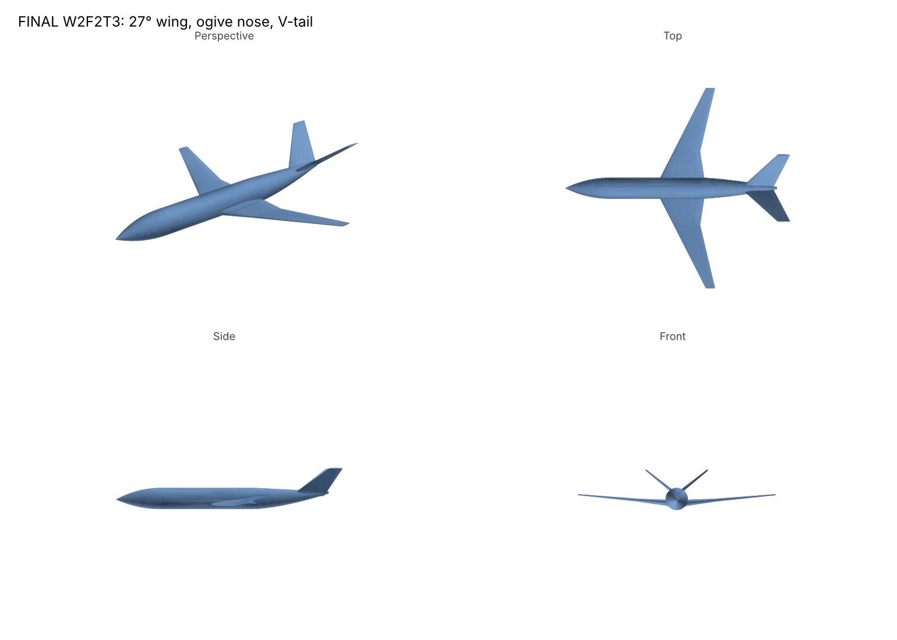
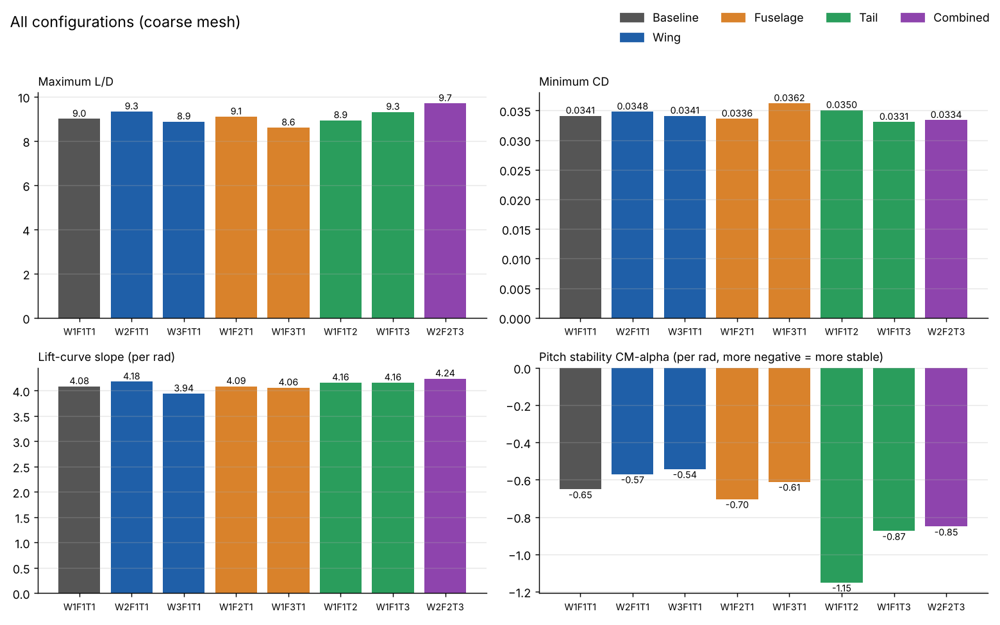
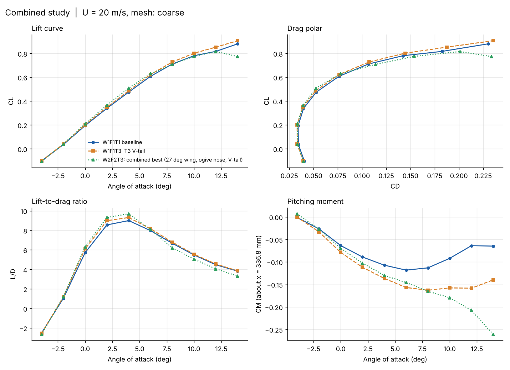

# Optimizing Plane Design Using CFD Analysis

A parametric CFD study of **CDF-62**, a twin-jet transport-aircraft concept modelled at 1:100 scale. Three wing shapes, three fuselage shapes and three tail layouts were simulated one change at a time against a baseline, and the best option from each group was combined into a final design.



*All eight configurations (1:100 model)*

## Result

The final design, **W2F2T3** (27° wing sweep, ogive nose, V-tail), improved on the baseline in every headline metric:

| Metric | Baseline W1F1T1 | Final W2F2T3 | Change |
|---|---|---|---|
| Maximum L/D | 9.0 | 9.7 | +7.8% |
| Minimum C<sub>D</sub> | 0.0341 | 0.0334 | −2.1% |
| Lift-curve slope C<sub>Lα</sub> (per rad) | 4.08 | 4.24 | +3.9% |
| Pitch stability C<sub>Mα</sub> (per rad) | −0.65 | −0.85 | 31% more stable |



*Final design W2F2T3: perspective, top, side and front views*

## Design variables

Each configuration is named W#F#T# (wing, fuselage, tail). The baseline is W1F1T1.

| Code | Wing (W) | Fuselage (F) | Tail (T) |
|---|---|---|---|
| 1 | 35° leading-edge sweep | Elliptical nose, 1.8 m tail upsweep | Conventional (fin + low tailplane) |
| 2 | 27° leading-edge sweep | Tangent-ogive nose, 13 m long | T-tail |
| 3 | 35° sweep + blended winglet | High tail upsweep (3.2 m), later tail-cone start | V-tail (38.6° dihedral) |

Common geometry (full scale): 62 m fuselage, 6.2 m diameter, 58.76 m projected span, low wing with 5° dihedral, NASA SC(2) supercritical airfoils (14% root to 10% tip), NACA 0010 tail surfaces. Projected span and mean-chord position are held constant across wing variants so comparisons are like-for-like.

## All configurations

Coarse mesh, U = 20 m/s, angle of attack −4° to 14°.

| Config | Change from baseline | Max L/D | Min C<sub>D</sub> | C<sub>Lα</sub> (/rad) | C<sub>Mα</sub> (/rad) |
|---|---|---|---|---|---|
| W1F1T1 | Baseline | 9.0 | 0.0341 | 4.08 | −0.65 |
| W2F1T1 | 27° sweep | 9.3 | 0.0348 | 4.18 | −0.57 |
| W3F1T1 | Winglet | 8.9 | 0.0341 | 3.94 | −0.54 |
| W1F2T1 | Ogive nose | 9.1 | 0.0336 | 4.09 | −0.70 |
| W1F3T1 | High upsweep | 8.6 | 0.0362 | 4.06 | −0.61 |
| W1F1T2 | T-tail | 8.9 | 0.0350 | 4.16 | −1.15 |
| W1F1T3 | V-tail | 9.3 | 0.0331 | 4.16 | −0.87 |
| **W2F2T3** | **Combined** | **9.7** | **0.0334** | **4.24** | **−0.85** |



*Summary of all configurations*

### Findings by group

- **Wing.** Reducing sweep to 27° gave the best L/D and lift slope. The winglet (W3) did not pay off at this Reynolds number: same minimum drag, lower lift slope.
- **Fuselage.** The ogive nose cut minimum drag and slightly improved stability. The high-upsweep tail cone added the most drag of any variant.
- **Tail.** The T-tail was by far the most stable (C<sub>Mα</sub> −1.15) but cost L/D. The V-tail had the lowest drag of the whole study while still being much more stable than the baseline, so it was picked for the final design.

### Combined design



*Combined study polars: baseline, V-tail only, and final design*

The combined design has the highest L/D peak (around 4° AoA) and the steepest stable pitching-moment slope. One trade-off to note: above about 12° its lift curve flattens and drops earlier than the baseline, so its stall margin is smaller.

Polars for each group are in the plots folder ([compare_wing.png](plots/compare_wing.png), [compare_fuselage.png](plots/compare_fuselage.png), [compare_tail.png](plots/compare_tail.png)). Pitching moment is taken about x = 336.8 mm on the 1:100 model.

## Repository layout

| Folder | Contents |
|---|---|
| [`models/scad/`](models/scad) | Parametric OpenSCAD source, one file per configuration |
| [`models/stl/`](models/stl) | Exported 1:100 meshes (millimetres) |
| [`plots/`](plots) | Polars and summary charts from the CFD runs |
| [`docs/images/`](docs/images) | Renders of the configurations |

## Using the models

The `.scad` files are all the same parametric model, each pre-set to one configuration with three switches at the top:

```openscad
wing_type = 2;  // 1 = 35° sweep, 2 = 27° sweep, 3 = winglet
fuse_type = 2;  // 1 = baseline, 2 = ogive nose, 3 = high upsweep
tail_type = 3;  // 1 = conventional, 2 = T-tail, 3 = V-tail
```

Other settings:

- `units = 10` exports millimetres of the 1:100 model (for printing); `units = 0.01` exports metres of the 1:100 model (for CFD meshing).
- `part` selects `"assembly"` or a printable part: `"fuselage_shell"`, `"wing_right"`, `"wing_left"`, `"tail"`, or `"cutaway"` (preview with internal components).
- `te_min` sets a minimum trailing-edge thickness. Keep `0` for CFD; use `0.05` (0.5 mm on the print) for FDM printing.

Open in OpenSCAD 2021.01 or newer, render with F6, then **File > Export > STL**. Fusion 360 can't open `.scad` files directly, so import the STL instead.

The printable layout is sized for a 1:100 flying model: 1.2 mm skin, a 6 mm carbon spar tube from root to kink, a top hatch, and space for a 3S 850 mAh LiPo, 30 A ESC, receiver, tail servo and 40 mm EDF.

## Limitations

- All results are from a **coarse mesh**; a mesh-independence study is still needed before quoting absolute values.
- Runs are at U = 20 m/s on a 1:100 model, so the Reynolds number is far below full scale. Trends between configurations are more reliable than absolute coefficients.
- Each group was varied with the other two held at baseline; interaction effects were only checked for the one combined design.
